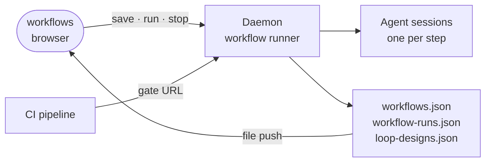

# intentic-workflows

Installs as **`intentic.workflows`**, from the registry (Extensions → Browse) or by repository URL at a commit. It is a first-party intentic extension that is listed in the registry rather than baked into the sandbox, so it arrives only where someone installs it. It was moved out of the monorepo at `intentic/intentic@9dc39fee6822`, where it lived at `_extensions/workflows`; this repository is its home now.

The Workflows rail view is where the owner designs graphs of agent sessions, each producing a declared output, then runs them and watches the runs. The same page keeps saved loop designs.



## What lives where

- **This repository holds the designer and the run page, not the engine.** The daemon runs the steps whether or not this extension is installed. It keeps designs in `.intentic/config/workflows.json` and runs in `.intentic/records/workflow-runs.json`, and serves the `/workflows` routes and the release gate.
- **The rest of the editor handles runs without this extension:**
  - The agents board shows each run with Stop, archive and restore.
  - The chat draws a run's diagram and opens its sessions.
  - The composer's "Run through" menu can send a message through a saved workflow or loop.
- **Without this extension you can't design.** Creating or editing a workflow or a loop needs this page.
- **Edits are pure functions.** A step names the steps it `needs`, and may carry a goal, a prompt, a declared output and a persona. Edits go through `src/workflowEdit.ts`, which keeps every `needs` pointing at a real step and the graph acyclic.
- **One picture for designing and watching.** The designer and the run page both draw from `src/graph/workflowDag.ts`. The editor's chat draws a run from its own copy of the same derivation, so a step looks the same in both places.
- **A release gate lets CI run a workflow and wait for one step's verdict.** `src/gateSnippets.ts` writes the wiring for the `intentic/gate-action` step. That step reads the gate URL from a secret, because the URL carries its token.
- **Nothing fires on its own.** A design runs when it's started from this page, the chat composer or a gate. Templates prefill the designer and create nothing until Save.
- **The rail badge shows runs in flight,** and the tile is on the rail only while one runs.

## Key files

- [src/extension.ts](src/extension.ts): registers the rail view and starts the in-flight badge.
- [src/WorkflowsView.vue](src/WorkflowsView.vue): the page, with saved workflows, loops and recent runs.
- [src/WorkflowDesigner.vue](src/WorkflowDesigner.vue): the graph editor, step inspector and gate panel.
- [src/graph/workflowDag.ts](src/graph/workflowDag.ts): a workflow, with or without a run, as a layered graph.
- [src/workflowEdit.ts](src/workflowEdit.ts): the edit operations and the rules they keep.
- [src/gateSnippets.ts](src/gateSnippets.ts): the CI wiring text for a release gate.

## Commands

```sh
pnpm install
pnpm run verify   # build, typecheck, then vitest and the node checks against the built bundle
```

The browser bundle in `dist/` is committed. A source change ships with `pnpm run build` and the rebuilt `dist/` in the same commit. To see a change running in a sandbox before it is pushed and pinned, run `extension dev workflows` there, and `extension dev workflows --off` to go back.
